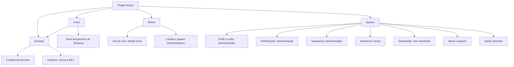
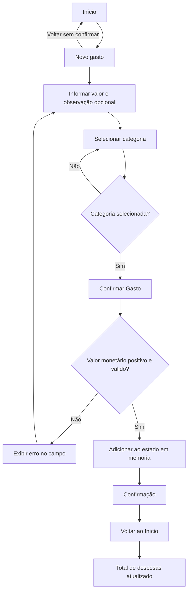
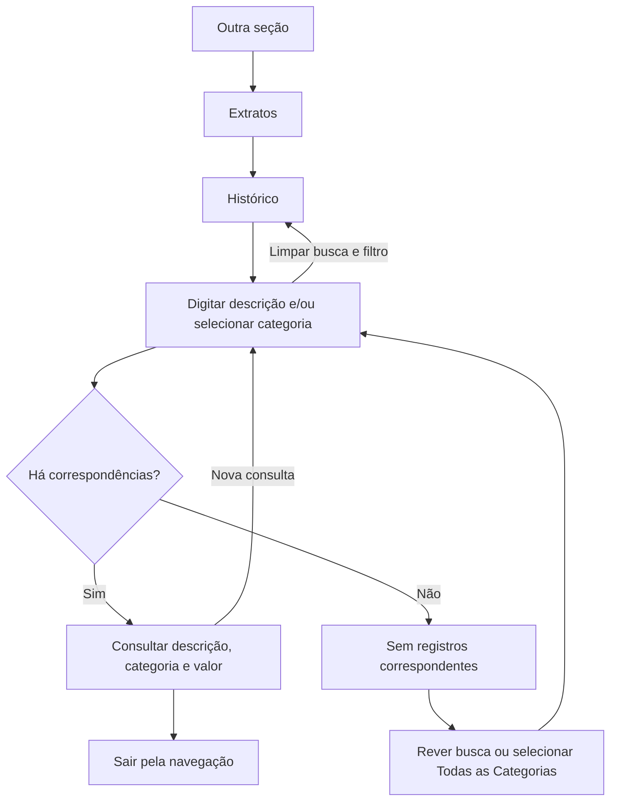
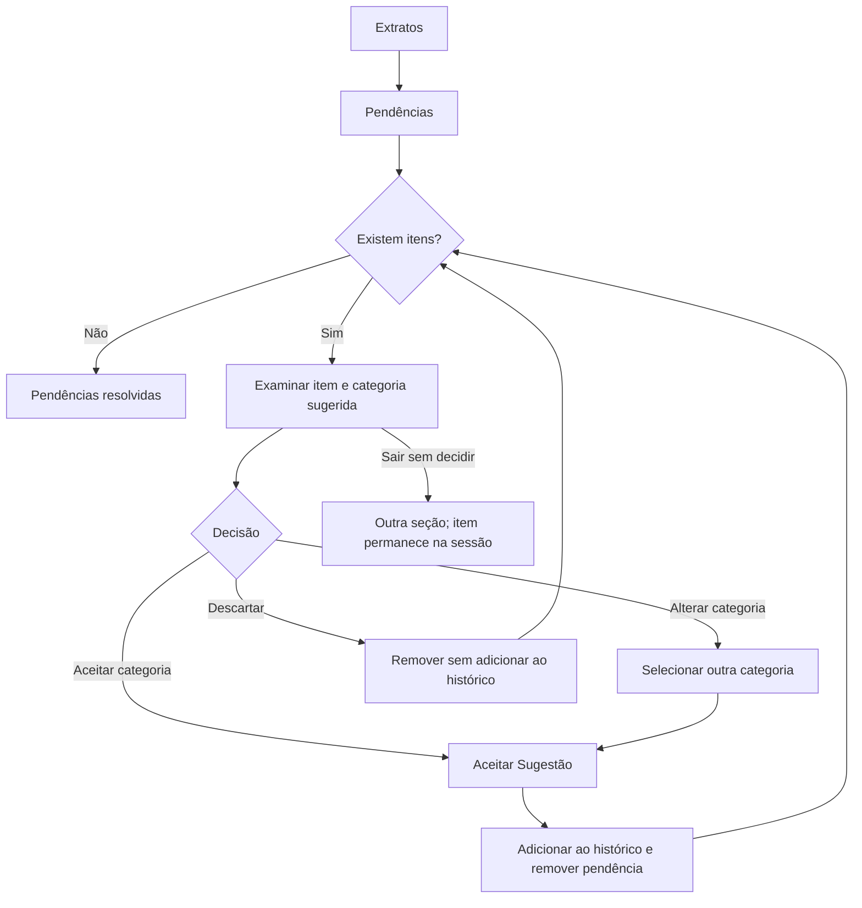
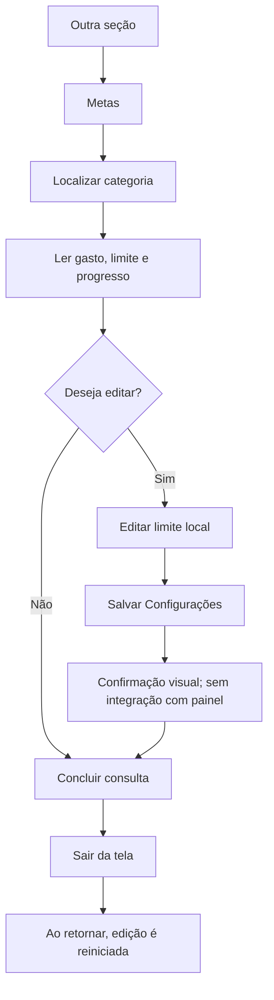

# Arquitetura de Informação e Fluxo do Usuário

Referência: [projeto React](14_implementacao_react.md). Os diagramas descrevem o código atual e seus limites. A [alta fidelidade HTML](15_prototipacao_alta_fidelidade.md) possui escopo próprio.

## Sitemap

As seções separam registro cotidiano, consulta, orçamento e preferências. Novo gasto atende à necessidade de registro rápido (12 de 18 respondentes relatam esquecimento). Categorias e limites apoiam necessidades dos relatos Q4–Q6. Essa organização é uma hipótese de design a avaliar, não comprovação de usabilidade.

## F1 — Registrar despesa

Objetivo: registrar um gasto e conferir sua presença no histórico e no total de despesas da sessão.

O frontend exige valor positivo com até duas casas decimais, interpreta moeda brasileira e mostra erro sem cadastrar entradas inválidas. Não há banco de dados. O retorno ocorre por ação do usuário após a confirmação.

## F2 — Consultar histórico

Objetivo: localizar despesa por descrição e categoria, sem alterar o lançamento.

O atalho “Ver relatório” também leva a Extratos. Esse rótulo é uma pendência; o destino atual não oferece relatório analítico. Não há edição de categoria de lançamentos confirmados.

## F3 — Tratar pendência demonstrativa

Objetivo: decidir se uma despesa fictícia deve entrar no histórico e com qual categoria.

Itens e sugestões são predefinidos. Aceitar já move o item; não há importação OFX, chamada de IA ou confirmação coletiva. Descartar remove o item, sem abrir edição nem oferecer desfazer.

## F4 — Consultar orçamento por categoria

Objetivo: interpretar gasto, limite e progresso de uma categoria no cenário demonstrativo.

Consultar é o fluxo inicial de avaliação. O caminho de edição mostra a limitação de salvamento. Gastos por categoria são fixos e não acompanham novas despesas.

## Evoluções planejadas

Receitas, edição posterior de categoria, relatório analítico, exportação real e persistência permanecem planejados. Configurar ciclo e limites precisa de integração antes de ser apresentado como salvamento funcional. A cobertura dos modelos de tarefas está indicada no [capítulo 6](6_analise_tarefas.md).
